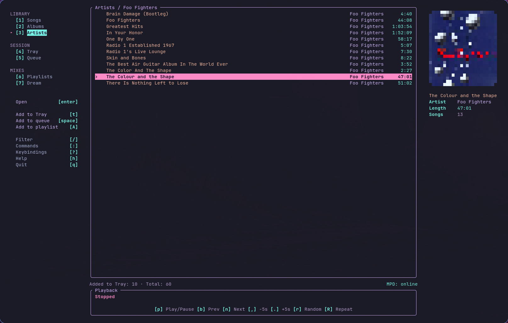
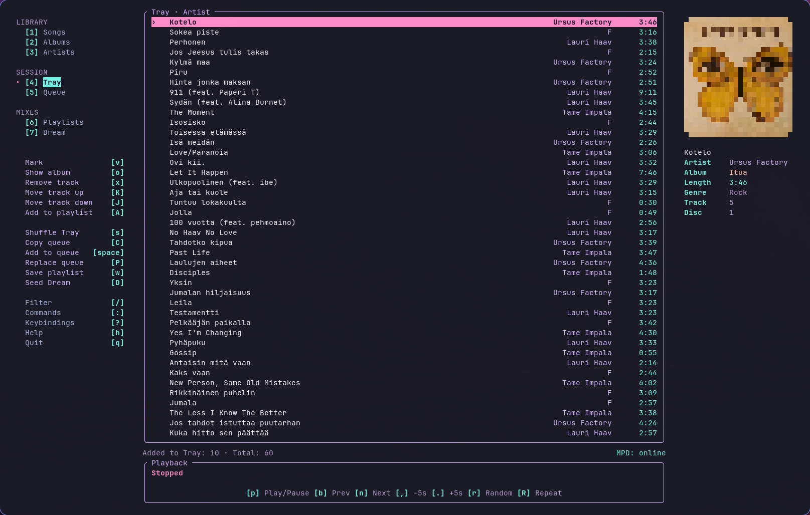
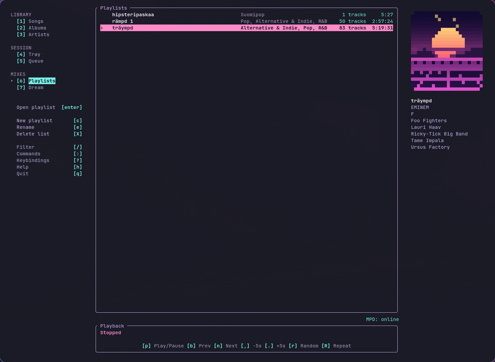

# rämpd player


A keyboard-first terminal client for [Music Player Daemon (MPD)](https://www.musicpd.org/). Browse your library, arrange tracks in a saved **Tray**, and use **Dream** to build a listening preview from music you already have. MPD handles playback and owns the live queue. rämpd does not start MPD or modify music files.

I started rämpd after recovering much of my old music library. I liked how programmable MPD was, but I had trouble finding a client that felt good for the age of streaming music players. I wanted a terminal player that made it enjoyable to put together playlists and mixes. Rämpd is a best estimation of what that could. The player is already customizable, but feel free to fork it and make your own run if it feels like it.

## Screenshots

| Albums | Tray | Playlists |
| :---: | :---: | :---: |
| [](screenshots/albums.png) | [](screenshots/tray.png) | [](screenshots/playlists.png) |

## Install

Release downloads support Linux and macOS on x86-64 and ARM64. Once a [GitHub release](https://github.com/juliusrajala/r-mpd/releases) is available, download the installer:

```sh
curl -fL -o install-rampd.sh https://github.com/juliusrajala/r-mpd/releases/latest/download/install.sh
```

Choose one path:

- **rämpd only:** Run `bash install-rampd.sh`. It verifies the archive checksum and installs the client in `~/.local/bin`. It does not change MPD.
- **rämpd + local MPD:** Run `bash install-rampd.sh --with-mpd "$HOME/Music"`. Replace `"$HOME/Music"` with your music directory. The installer uses Homebrew, pacman, APT, or DNF if MPD or its setup tool `mpc` is missing. It creates a separate MPD configuration with a private Unix socket and stickers enabled. It does not overwrite an existing configuration. Follow the printed commands to start that instance, index your music, and open rämpd. MPD 0.24 or newer is needed to record play counts.

Run `rampd` or `rämpd` if `~/.local/bin` is on your `PATH`. Otherwise, use `~/.local/bin/rampd`.

### Build from source

Start MPD and let it index your music. From this repository, use the Go version in [`go.mod`](go.mod) or later:

```sh
go run ./cmd/rampd
```

To install the `rampd` command locally, run `go install ./cmd/rampd`. Put the Go binary directory on your `PATH` to run `rampd` from anywhere. Otherwise, use the full path to the installed binary.

By default, rämpd connects to `127.0.0.1:6600`. To use another MPD server or a Unix socket:

```sh
go run ./cmd/rampd -host jukebox.local -port 6600
go run ./cmd/rampd -host /path/to/mpd/socket
```

MPD does not encrypt TCP connections. Use a trusted network or an SSH tunnel for a remote server.

## Browse and play

The player opens in **Songs**. Press `1`–`7` to switch to Songs, Albums, Artists, Tray, Queue, Playlists, or Dream. Wide terminals center the main list between equal-width panels for navigation and artwork. The side panels have no borders. Narrow terminals keep navigation above the list. The main list and Playback have borders when space allows.

| Key | Action |
| --- | --- |
| `Tab` / `Shift+Tab` | Switch views |
| `j` / `k` or `↓` / `↑` | Move the selection |
| `←` / `Backspace` or `→` / `l` | Go back or open the selection |
| `Enter` | Open a group or play the selected track |
| `Space` | Append a library selection to the live queue |
| `/` | Filter the current list as you type. `Enter` keeps the filter and `Esc` clears it |
| `o` | Sort Songs or Albums by title or artist. In Tray, Queue, Dream, or an open playlist, switch the artist and album column without changing track order |
| `p`, `n`, `b` | Play or pause, skip forward, or skip back |
| `i` | Focus the playing or paused entry in Queue. Clears the Queue filter only if it hides that entry |
| `,` / `.` | Seek backward or forward five seconds |
| `r` / `R` | Toggle random playback or repeat |
| `:` | Focus the command palette. Type to filter, use `↑` / `↓` to select, and press `Enter` to run the command |
| `?` / `h` / `q` | Show keybindings, open the guide, or quit |

When space allows, the menu under navigation groups actions for the current view. **Help** explains how the Library, Queue, Tray, Dream, and Playlists work together. **Keybindings** separates General, Playback, and By view shortcuts. Use the arrow keys or Page Up and Page Down to scroll. The searchable palette uses that menu without replacing the list. In compact terminals, it opens in the main panel instead. View switches stay in navigation. Playback shortcuts stay in the Playback box. The palette does not repeat them.

Playing a track from the library or a stored playlist appends it before playback. It does not replace the queue. When MPD notifications are available, the player picks up changes from other clients automatically. Otherwise it polls for playback and queue changes. Use `Ctrl+R` to refresh the library or playlists manually.

### Song dates and play counts

The details panel shows **Last played** and play counts for the current and previous UTC years. It also shows **Added** and **Modified** dates when MPD supplies them. Added is the date MPD added the track to its library. Modified is the date the audio file last changed.

While rämpd is open, it records an observed play after 30 seconds or half the track, whichever comes first. Seeking does not add listening time. A pause does not start a new play. Plays that rämpd cannot distinguish, such as a seamless repeat of one queue entry, may count only once. Run one rämpd instance per MPD server to avoid counting the same play twice.

MPD must have a `sticker_file` and support `sticker inc`. rämpd writes the qualification time to `rampd.last_played` and increments `rampd.playcount.YYYY` for that UTC year. Stickers do not change the audio file. If the write fails, playback continues and rämpd shows a notice.

### Tray: plan a mix without changing playback

Press `t` while browsing to collect the highlighted artist, album, or track. This skips tracks already in the Tray. Press `4` to open the Tray. Track edits and actions for the whole Tray are available together.

- **Edit tracks:** Use `J` / `K` to move tracks down or up and `x` to remove them. Press `v` to mark tracks for a group edit. With no marks, edits apply to the highlighted track. Marks survive filtering, and edits include hidden marked tracks. Press `Esc` to clear a filter, then press it again to clear marks.
- **Whole Tray:** Press `C` to copy the live queue, `Space` to append the Tray to it, `w` to save a playlist, or `D` to preview a Dream. Press `P` to replace the queue after confirmation. If the current track is retained, playback keeps its position. Otherwise it stops without starting another track. Press `s` to shuffle the Tray without changing the live queue. Press `d` or choose **Remove duplicates** in the command palette to keep the first copy of each track in order. These actions use the full Tray, not just visible or marked tracks.

You can also copy the live queue with `C` from **Queue**. Copying preserves order and repeats and asks before replacing a nonempty Tray. The Tray saves automatically to `$XDG_STATE_HOME/rampd/tray.json`, or `~/.local/state/rampd/tray.json` by default. Marks do not persist. Restoring the Tray does not change playback.

### Queue and playlists

In **Queue**, `J` / `K` moves a track, `x` removes it, `s` shuffles the queue, and `X` clears it after confirmation. Press `w` to save the queue as a new MPD playlist.

The **Playlists** list shows each playlist's top three genres, track count, and total length when space allows. The selection preview lists the artists in the highlighted playlist. When there is room, it also shows a synthwave cover generated from the playlist name. Renaming the playlist changes its cover.

In the **Playlists** list, `c` creates a playlist, `e` renames it, and `X` asks before deleting it. Open a playlist to reorder or remove tracks, or use `a` to append the full playlist to the queue. Press `A` on an eligible selection to add it to an existing playlist by name.

### Dream: preview a listening session

Press `7`, then `g` for a preview from your whole library. Or press `D` in the **Tray** for other tracks that match the artist, album artist, or genre tags in the Tray. Dream runs locally, skips duplicate tracks, and avoids consecutive tracks by the same artist when possible. The default target is 25 tracks (`-dream-count` changes it).

Generating a preview does not change the Tray or queue. From Dream, `Space` appends the preview, `Enter` appends and plays it, `P` replaces the queue and starts playback after confirmation, and `w` saves it as a new playlist.

## Configuration

The optional config file is `$XDG_CONFIG_HOME/rampd/config.toml`, or `~/.config/rampd/config.toml` by default. Use `-config PATH` for a different file. Command-line flags take precedence over `MPD_HOST` and `MPD_PORT`, which take precedence over the file. For authentication, prefer `MPD_PASSWORD`. The player also accepts `password@host` in `MPD_HOST` or `mpd.password` in a private config file.

```toml
[mpd]
host = "127.0.0.1"
port = 6600
timeout = "5s"

[ui]
artwork = true

[dream]
track_count = 25

[keybindings]
play_pause = ["p", "ctrl+p"]

[theme]
progress_played = "#77F5E5"
progress_unplayed = "#3A3743"
```

Set `artwork = false` or pass `-artwork=false` to hide the Selection panel. Key names are case-sensitive. Use names such as `space`, `enter`, or `ctrl+r` for special keys. The first key in each list appears in hints. Use `[]` to unbind an action. See [default keybindings](internal/keymap/keymap.go) for the action names. Text prompts keep their standard `Enter` and `Esc` controls. `Ctrl+C` always quits.

Theme overrides use `#RRGGBB` colors. The `progress_played` color also applies to track lengths and playback times. Omitted colors keep their Synthwave defaults. See the [full palette](docs/theme.md) and restart the player after editing it.

## Development checks

```sh
go test ./...
go vet ./...
```

On Linux, install `mpd` and `ffmpeg` to run the tests with a disposable MPD server:

```sh
RAMPD_MPD_INTEGRATION=1 go test -race -count=1 ./...
```

For a keyboard smoke test, also install `tmux` and `python3`, then run `bash scripts/smoke.sh`. These tests use fixture music and a private socket. They do not use your normal MPD server. See the [release checklist](docs/release-checklist.md) for packaging checks.

## License

[MIT](LICENSE).
